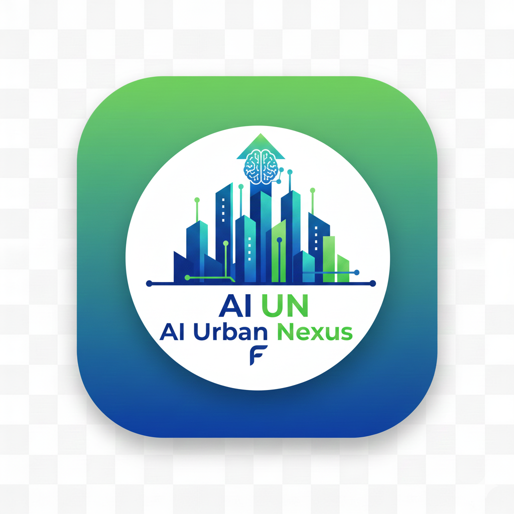

# AI Urban Nexus — Mobile Application

<div align="center">



**AI-powered urban intelligence for Pakistan — crime detection, smart traffic, energy forecasting, and safe route planning.**

[](https://flutter.dev)
[](https://dart.dev)
[](https://firebase.google.com)
[](https://huggingface.co/spaces/abbasorakzai777/ai-urban-nexus-pakistan)
[](LICENSE)
[](#running-locally)

**COMSATS University Islamabad — Final Year Project (2025–26)**

[Repository](https://github.com/ZaheerAbbasOrakzai/ai-urban-nexus) · [Features](#features) · [Architecture](#architecture) · [AI Integration](#ai-integration) · [Installation](#installation) · [Contributing](CONTRIBUTING.md)

</div>

---

## Overview

**AI Urban Nexus** is the official cross-platform Flutter mobile application for an AI-assisted smart city platform focused on Pakistan's urban mobility, public safety, and energy management. The app connects to Hugging Face Spaces for machine learning inference, Firebase for real-time data and authentication, and Google Maps for geospatial visualization.

| Capability | Description |
|---|---|
| Crime detection | Upload vehicle images; AI flags stolen/suspicious plates |
| Smart traffic | Congestion prediction with peak-hour and accident context |
| Energy forecasting | City-level transport energy demand (MWh) predictions |
| Route planning | Multi-route navigation with safety and traffic scoring |
| Real-time alerts | Firebase-backed crime, traffic, SOS, and energy alerts |
| Admin analytics | Role-gated KPI dashboards for operators |

---

## Screenshots

> Add screenshots to `docs/screenshots/` and update the paths below.

| Dashboard | Crime Detection | Traffic Prediction | Energy Forecast |
|:---:|:---:|:---:|:---:|
| _Coming soon_ | _Coming soon_ | _Coming soon_ | _Coming soon_ |

---

## Features

### Authentication and roles
- Splash, login, and registration flows
- Role-based access: `admin`, `trafficOfficer`, `securityLead`, `energyManager`, `viewer`
- Session persistence via SharedPreferences

### Dashboard and navigation
- Bottom navigation across Home, Map, Routes, Traffic, Alerts, Crime, Energy, and Profile
- Live city statistics from Firebase Realtime Database
- Urdu/English toggle on the home tab

### Crime detection
- Camera or gallery image capture
- Hugging Face crime model inference
- Automatic Firebase alert storage with optional image upload to Storage
- Local notification on stolen-vehicle detection

### Smart traffic and prediction
- Gradio API traffic congestion prediction (city, junction, vehicles, speed, temperature, peak hour, accident flag)
- Structured traffic recommendations via Hugging Face Space
- Optional local FastAPI backend on port 8002
- Offline heuristic fallback when the API is unavailable

### Energy forecasting
- Tomorrow's transport energy demand per Pakistani city
- FL Chart visualization of hourly demand curves
- Predictions cached locally for offline viewing

### Maps and routing
- Google Maps (mobile) and Flutter Map (web fallback)
- Geolocation, geocoding, and polyline route rendering
- Safe route planner with crime/traffic-aware scoring

### Notifications and alerts
- Firebase Cloud Messaging + local notifications
- Streams for crime, traffic, SOS, and energy alerts

### Admin and diagnostics
- Admin analytics (crime, traffic, energy, safe routes KPIs)
- Health check screen for API connectivity verification

---

## Architecture

```
┌─────────────────────────────────────────────────────────────┐
│                    Flutter UI (lib/features)                │
│  auth · dashboard · map · crime · traffic · energy · admin  │
└──────────────────────────┬──────────────────────────────────┘
                           │
┌──────────────────────────▼──────────────────────────────────┐
│              Core Layer (lib/core)                          │
│  config · services · widgets · utils · web                  │
└──────┬──────────────┬──────────────┬────────────────────────┘
       │              │              │
       ▼              ▼              ▼
┌────────────┐ ┌─────────────┐ ┌─────────────────────────────┐
│ Hugging    │ │ Firebase    │ │ Optional local backend      │
│ Face APIs  │ │ Auth · RTDB │ │ ports 8000–8003 (orchestrator)│
│ (Gradio)   │ │ Firestore   │ │ WebSocket :8000/ws/vehicles │
│            │ │ Storage ·   │ └─────────────────────────────┘
│            │ │ FCM         │
└────────────┘ └─────────────┘
```

| Layer | Technology |
|---|---|
| UI | Flutter 3.24+, Material 3 |
| State | Flutter Riverpod 3.x |
| Navigation | Go Router 17.x |
| HTTP | Dio, `http` package |
| Real-time | Socket.IO client, Firebase streams |
| Local storage | Hive, SharedPreferences |
| Maps | Google Maps Flutter, Flutter Map, Geolocator |

---

## AI Integration

Models are deployed on [Hugging Face Spaces](https://huggingface.co/spaces). The mobile app calls Gradio-compatible HTTP endpoints defined in `lib/core/config/api_endpoints.dart`.

### 1. Crime Detection

| Property | Value |
|---|---|
| Space | [abbasorakzai777/crime_detection](https://huggingface.co/spaces/abbasorakzai777/crime_detection) |
| Base URL | `https://abbasorakzai777-crime-detection.hf.space` |
| Endpoint | `POST /run/predict` |
| Service | `ApiService.detectCrime()` |

**Request:** `multipart/form-data` with image file in field `data`.

**Response (Gradio):**
```json
{
  "data": ["<base64_image_or_url>", "STOLEN — plate ABC-123 detected"]
}
```

**App parsing:** Extracts `data[1]` as alert text; sets `isStolen = true` when text contains `"STOLEN"`.

**Error handling:** Returns offline message when no connectivity; 30 s timeout.

---

### 2. AI Urban Nexus Pakistan (Energy + Traffic)

| Property | Value |
|---|---|
| Space | [abbasorakzai777/ai-urban-nexus-pakistan](https://huggingface.co/spaces/abbasorakzai777/ai-urban-nexus-pakistan) |
| Base URL | `https://abbasorakzai777-ai-urban-nexus-pakistan.hf.space` |

#### Energy prediction

| Property | Value |
|---|---|
| Endpoint | `POST /gradio_api/predict_energy` |
| Service | `ApiService.predictEnergy(city)` |

**Request:**
```json
{ "data": ["Lahore"] }
```

**Response:**
```json
{ "data": ["Lahore\nTomorrow's Transport Energy Demand: 38210 MWh"] }
```

**Fallback:** City-specific heuristic MWh estimates when API fails.

#### Traffic congestion prediction

| Property | Value |
|---|---|
| Endpoint | `POST /gradio_api/predict_congestion` |
| Service | `ApiService.predictTraffic(...)` |

**Request:**
```json
{
  "data": ["Lahore", 3, 1500, 25.0, 30.0, true, false]
}
```
Parameters: `city`, `junction`, `vehicles`, `speed`, `temperature`, `isPeakHour`, `accident`.

**Response:**
```json
{ "data": ["Moderate Traffic • approx 35.0 km/h in Lahore"] }
```

#### Structured traffic (Smart Traffic assistant)

| Property | Value |
|---|---|
| Endpoint | `POST /run/predict` |
| Service | `HFSpaceService.predictTrafficStructured(...)` |

**Request:**
```json
{ "data": ["Lahore", "morning", "Monday"] }
```

**Expected response object:**
```json
{
  "congestion_level": "High",
  "average_speed_kmh": 22,
  "predicted_delay_minutes": 18,
  "ai_recommendation": "Use alternate route via ..."
}
```

**Retry logic:** Up to 5 retries on 503 (Space loading) with exponential backoff.

**Optional auth:** `--dart-define=HF_SPACE_TOKEN=hf_...` for private Spaces.

---

### Optional local backend

When a FastAPI orchestrator runs locally (or on Render via `BACKEND_BASE`):

| Service | Port path | Endpoint |
|---|---|---|
| Orchestrator | `:8000/orch` | `/orchestrate_crime_response`, `/orchestrate_energy_prediction` |
| Crime local | `:8000/crime` | `/detect_stolen_vehicle` |
| Traffic | `:8000/traffic` | `/predict`, `/simulate_traffic` |
| Energy | `:8000/energy` | `/predict_energy` |
| WebSocket | `:8000` | `/ws/vehicles` |

Configure with:
```bash
flutter run --dart-define=BACKEND_BASE=https://your-app.onrender.com
```

---

## Datasets

The Hugging Face models are trained on custom Kaggle datasets:

### 1. Pakistan Urban Transport Energy Management
- **URL:** [kaggle.com/datasets/zaheerabbasorakzai/pakistan-urban-transport-energy-managment](https://www.kaggle.com/datasets/zaheerabbasorakzai/pakistan-urban-transport-energy-managment)
- **Purpose:** Urban transport energy consumption across Pakistani cities
- **Features:** City, vehicle type, fuel type, distance, energy (kWh/MWh), timestamps
- **Target:** Transport energy demand (MWh)
- **App usage:** Powers `predict_energy` model and energy forecast charts

### 2. Stolen Vehicles in Pakistan
- **URL:** [kaggle.com/datasets/zaheerabbasorakzai/stolen-vehicles-in-pakistan-dataset](https://www.kaggle.com/datasets/zaheerabbasorakzai/stolen-vehicles-in-pakistan-dataset)
- **Purpose:** Vehicle theft records for Pakistan
- **Features:** Plate number, make/model, color, theft location, date, recovery status
- **Target:** Stolen vs. safe classification
- **App usage:** Trains crime detection model; enriches Firebase crime alerts

### 3. Pakistan Smart Traffic Management
- **URL:** [kaggle.com/datasets/zaheerabbasorakzai/pakistan-smart-traffic-management](https://www.kaggle.com/datasets/zaheerabbasorakzai/pakistan-smart-traffic-management)
- **Purpose:** Traffic flow and congestion patterns
- **Features:** Junction ID, vehicle count, average speed, road type, hour, weather, accidents
- **Target:** Congestion level, predicted delay, average speed
- **App usage:** Powers traffic prediction and smart traffic assistant

---

## Technology Stack

| Category | Packages |
|---|---|
| Framework | Flutter, Dart |
| State | flutter_riverpod |
| Routing | go_router |
| Network | dio, http, connectivity_plus, socket_io_client |
| Firebase | firebase_core, firebase_auth, firebase_database, cloud_firestore, firebase_storage, firebase_messaging |
| Maps | google_maps_flutter, flutter_map, geolocator, geocoding, flutter_polyline_points |
| UI | fl_chart, lottie, flutter_svg, dotted_border |
| Storage | shared_preferences, hive, hive_flutter |
| Media | image_picker, permission_handler, just_audio, speech_to_text, flutter_tts |

---

## Installation

### Requirements
- Flutter **3.24.0+** and Dart **3.5.0+**
- Android SDK (API 21+) / Xcode 14+ (iOS) / Chrome (web)
- Firebase project with Android and iOS apps registered
- Google Maps API key (Maps SDK, Directions, Geocoding as needed)
- Git

### Clone

```bash
git clone https://github.com/ZaheerAbbasOrakzai/ai-urban-nexus.git
cd ai-urban-nexus
flutter pub get
```

### Firebase setup

1. Create a project at [Firebase Console](https://console.firebase.google.com).
2. Add Android (`com.example.ai_urban_nexus_mobile`) and iOS apps.
3. Download and place:
   - `android/app/google-services.json`
   - `ios/Runner/GoogleService-Info.plist`
4. Enable Authentication, Realtime Database, Firestore, Storage, and Cloud Messaging.
5. Run `flutterfire configure` if regenerating `lib/firebase_options.dart`.

### API keys and environment

1. Copy `.env.example` to `.env` (local only — never commit).
2. Copy `android/local.properties.example` to `android/local.properties` and set `MAPS_API_KEY`.
3. Run with Dart defines:

```bash
flutter run \
  --dart-define=GMAPS_API_KEY=your_key \
  --dart-define=GMAPS_ROUTES_API_KEY=your_key \
  --dart-define=HF_SPACE_TOKEN=your_token
```

See [SETUP.md](SETUP.md) for the full configuration guide.

---

## Running locally

```bash
# Default device
flutter run

# Platform-specific
flutter run -d android
flutter run -d ios
flutter run -d chrome
flutter run -d windows
flutter run -d macos
flutter run -d linux
```

### Build release

```bash
# Android APK
flutter build apk --release

# Android App Bundle (Play Store)
flutter build appbundle --release

# Web
flutter build web --release

# Desktop
flutter build windows --release
```

Outputs:
- APK: `build/app/outputs/flutter-apk/app-release.apk`
- AAB: `build/app/outputs/bundle/release/app-release.aab`
- Web: `build/web/`

---

## Project structure

```
ai-urban-nexus/
├── android/                 # Android native project
├── ios/                     # iOS native project
├── web/                     # Web entry and manifest
├── windows/ linux/ macos/   # Desktop targets
├── assets/
│   ├── fonts/               # Poppins typeface
│   ├── icons/               # App and UI icons
│   ├── images/              # Logos and images
│   ├── lottie/              # Animations
│   └── sound/               # Audio assets
├── lib/
│   ├── core/
│   │   ├── config/          # Routes, theme, API endpoints, maps config
│   │   ├── services/        # API, auth, Firebase, HF, socket, notifications
│   │   ├── utils/           # Helpers, validators, extensions
│   │   ├── web/             # Web-specific map loader
│   │   └── widgets/         # Shared UI components
│   ├── features/            # Feature screens (auth, crime, traffic, energy, …)
│   ├── models/              # Data models
│   ├── app.dart             # GoRouter configuration
│   ├── firebase_options.dart
│   └── main.dart
├── test/                    # Widget tests
├── .github/                 # Issue and PR templates
├── firebase.json
├── pubspec.yaml
├── README.md
├── LICENSE
├── SETUP.md
├── CONTRIBUTING.md
├── SECURITY.md
└── CHANGELOG.md
```

---

## Project workflow

1. **Authenticate** — User logs in; role assigned from username pattern.
2. **Dashboard** — Live Firebase stats and quick actions.
3. **AI inference** — User triggers crime/traffic/energy features; app calls Hugging Face Gradio APIs.
4. **Persist results** — Predictions and alerts saved to Firebase Realtime Database / Storage.
5. **Notify** — Local and push notifications for critical events (stolen vehicle, SOS).
6. **Admin review** — Authorized roles view aggregated KPIs.

---

## Security

- API keys must be supplied via `--dart-define` or `android/local.properties` — never hardcoded in source.
- `.env`, `local.properties`, keystores, and certificates are gitignored.
- Review [SECURITY.md](SECURITY.md) before deploying to production.
- Restrict Google Maps and Firebase keys by app package/bundle ID in cloud consoles.
- Configure Firebase security rules for production workloads.

---

## Roadmap

- [ ] Firebase Auth integration (replace demo login)
- [ ] On-device model inference for offline crime detection
- [ ] Urdu voice assistant for traffic alerts
- [ ] CI/CD with GitHub Actions
- [ ] Play Store and App Store release
- [ ] Expanded city coverage beyond current 12 cities

---

## Contributing

Contributions are welcome. Please read [CONTRIBUTING.md](CONTRIBUTING.md) and [CODE_OF_CONDUCT.md](CODE_OF_CONDUCT.md) before opening a pull request.

1. Fork the repository
2. Create a feature branch: `git checkout -b feature/my-feature`
3. Commit changes with clear messages
4. Open a pull request against `main`

---

## Acknowledgements

- **COMSATS University Islamabad** — Academic supervision and FYP support
- **Flutter & Dart teams** — Cross-platform framework
- **Firebase & Google Cloud** — Backend infrastructure
- **Hugging Face** — Model hosting and Gradio APIs
- **Kaggle** — Dataset hosting
- **Open-source package maintainers** — See `pubspec.yaml`

---

## License

This project is licensed under the [MIT License](LICENSE).

Copyright © 2026 **Zaheer Abbas Orakzai**

---

## Contact

| | |
|---|---|
| **Author** | Zaheer Abbas Orakzai |
| **GitHub** | [@ZaheerAbbasOrakzai](https://github.com/ZaheerAbbasOrakzai) |
| **Repository** | [github.com/ZaheerAbbasOrakzai/ai-urban-nexus](https://github.com/ZaheerAbbasOrakzai/ai-urban-nexus) |
| **Crime Model** | [huggingface.co/spaces/abbasorakzai777/crime_detection](https://huggingface.co/spaces/abbasorakzai777/crime_detection) |
| **Urban Nexus Model** | [huggingface.co/spaces/abbasorakzai777/ai-urban-nexus-pakistan](https://huggingface.co/spaces/abbasorakzai777/ai-urban-nexus-pakistan) |

**Co-author:** Imtiaz Hussain

**Institution:** COMSATS University Islamabad, Sahiwal Campus — FYP 2025–26
